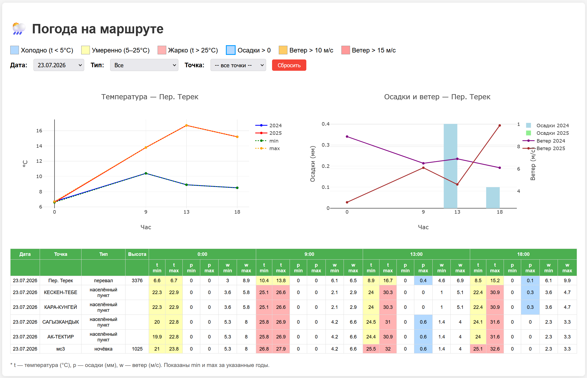

# 🌦 Weather Report Helper

**Инструмент для подготовки отчёта по погоде для велопоходов и других outdoor-мероприятий.**

Вы получаете интерактивный дашборд с исторической погодой (температура, осадки, ветер) для всех ключевых точек маршрута за указанные годы и часы.

---

## ✨ Возможности

- **Автоматический запрос высот** через Open‑Meteo Elevation API.
- **Загрузка точек из GPX‑файлов** (например, созданных на [nakarte.me](https://nakarte.me)) с автоматическим определением высот.
- **Объединение нескольких источников точек** в один маршрут с автоматическим назначением дат.
- **Дедупликация** точек по координатам — повторные запросы к API не выполняются.
- **Приведение названий населённых пунктов к верхнему регистру** (ТОКИО, ОДАВАРА).
- **Сортировка по дате** — итоговый CSV и дашборд идут в хронологическом порядке.
- **Гибкая настройка часового пояса** — один параметр `TIMEZONE` для всех запросов.
- **Динамический фильтр «Тип»** в дашборде — строится из уникальных значений входного CSV.
- **Интерактивный HTML‑дашборд** с фильтрами (по дате, типу, названию) и графиками:
  - изменение температуры в течение дня,
  - осадки и ветер (столбцы и линии),
  - цветовая подсветка экстремумов в таблице.

## Что вы получите

После запуска в папке `output/` появятся:

- **`points_cleaned.csv`** — очищенные данные (без дублей, с высотами, отсортированы по дате).
- **`points_full.csv`** — полная таблица с погодой за каждый год и час.
- **`dashboard.html`** — интерактивный отчёт. Откройте его в любом браузере.
- **`weather_points_with_elevation.csv`** (опционально) — CSV с высотами для дополнительных точек из GPX.

---

---

## 🚀 Быстрый старт

### 1. Установка

Убедитесь, что у вас установлен **Python 3.8+**. Установите зависимости:

```bash
pip install pandas requests
```

- **pandas** — для работы с таблицами,
- **requests** — для HTTP‑запросов к Open‑Meteo API.

### 2. Подготовка данных

Возможны три варианта — выберите подходящий.

#### Вариант А — готовый CSV (рекомендуется)

Создайте файл `points.csv` (UTF‑8, разделитель `;`) с колонками:

```
date;name;type;lat;lon;height
04.11.2026;ТОКИО;населённый пункт;35.68291;139.75831;13.0
05.11.2026;ЙОКОГАМА;населённый пункт;35.46518;139.62092;7.0
06.11.2026;ОДАВАРА;населённый пункт;35.25683;139.14871;48.0
```

- `date` — в формате `ДД.ММ.ГГГГ`,
- `height` — можно оставить пустым, скрипт запросит высоту автоматически,
- `type` — тип точки (например, «населённый пункт», «ночёвка», «перевал»). Если колонки нет, скрипт добавит её со значением `точка`.

Укажите путь к файлу в настройке `EXISTING_CSV`:

```python
EXISTING_CSV = "input/points_full.csv"
```

#### Вариант Б — автоматический сбор из GPX + плана

Скрипт умеет парсить исходные файлы:

- план похода в Markdown (`PLAN_FILE`) — извлекает высоты и типы точек,
- GPX‑файлы ночёвок, населённых пунктов и перевалов (`CAMPS_FILE`, `VILLAGES_FILE`, `PASSES_FILE`).

Достаточно указать их пути в настройках, и скрипт соберёт таблицу сам.

#### Вариант В — дополнительные точки из GPX (например, nakarte.me)

Если у вас есть только **GPX‑файл с точками для погоды** (например, `Погода_Япония.txt`, скачанный с [nakarte.me](https://nakarte.me)):

1. Поместите файл в папку `input/`.
2. Укажите путь в настройке:

```python
WEATHER_POINTS_GPX = "input/Погода_Япония.txt"
```

3. Запустите скрипт. Он:
   - извлечёт все точки,
   - запросит для каждой высоту через Open‑Meteo,
   - сохранит результат в `output/weather_points_with_elevation.csv`.

4. Чтобы эти точки **попали в основной отчёт**, задайте:

```python
WEATHER_POINTS_CSV = "output/weather_points_with_elevation.csv"
```

Скрипт объединит их с основным набором и **назначит даты**:

- по умолчанию — продолжит с последней даты основного маршрута (`AUTO_DATE_FROM_LAST = True`),
- либо запросит начальную дату через консоль (если в основном наборе нет дат или авто‑режим выключен).

> 💡 **Когда это нужно?**  
> Если основной маршрут уже есть в CSV (`EXISTING_CSV`), но вы хотите добавить
> ещё несколько точек — например, города по пути. Отметьте их на nakarte.me,
> скачайте GPX — и скрипт сам превратит их в CSV с высотами и вольёт в маршрут.

> ❌ **Когда не нужно?**  
> Если все точки уже есть в основном CSV — поставьте `WEATHER_POINTS_GPX = None`
> или закомментируйте строку. Скрипт пропустит этот шаг и не будет искать GPX.

**Пример из практики:** файл `Погода_Япония.txt` с точками **Одавара**, **Яманакако**, **Хаякава** →  
скрипт запросит высоты (≈ 48 м, 992 м, 320 м) → сохранит в `weather_points_with_elevation.csv` →  
при заданном `WEATHER_POINTS_CSV` точки попадут в итоговый отчёт с автоматически назначенными датами.

---

### 3. Запуск

```bash
python weather_report_helper.py
```

Скрипт по очереди запросит погоду для каждой точки и каждого года.  
**На одну точку и год уходит ~1–2 секунды.** Наберитесь терпения.

---

## ⚙️ Настройки

Все параметры собраны в верхней части скрипта — редактировать их удобно в любом редакторе.

### Основные

| Переменная | Описание | Пример |
|------------|----------|--------|
| `YEARS` | Список лет для анализа | `[2024, 2025]` |
| `HOURS` | Часы (местное время) для запроса | `[0, 9, 13, 18]` |
| `TIMEZONE` | Часовой пояс (IANA) | `"Asia/Tokyo"`, `"Europe/Moscow"`, `"UTC"` |
| `INPUT_DIR` / `OUTPUT_DIR` | Папки для входа и выхода | `"input/"`, `"output/"` |
| `EXISTING_CSV` | Путь к готовому CSV с точками | `"input/points_full.csv"` |

### Дополнительные источники точек

| Переменная | Описание |
|------------|----------|
| `WEATHER_POINTS_GPX` | GPX‑файл с точками, для которых нужно получить высоты и добавить в маршрут |
| `WEATHER_POINTS_CSV` | CSV с дополнительными точками, которые нужно объединить с основным маршрутом |
| `DEFAULT_TYPE` | Тип для дополнительных точек, если в CSV он не указан (по умолчанию `"населённый пункт"`) |

### Управление датами и дублями

| Переменная | Описание |
|------------|----------|
| `AUTO_DATE_FROM_LAST` | `True` — продолжать с последней даты основного набора; `False` — запросить у пользователя |
| `DEDUP_ROUND_DIGITS` | Точность округления координат для дедупликации (по умолчанию 5) |

> 💡 Полный список допустимых часовых поясов — в базе IANA:  
> <https://en.wikipedia.org/wiki/List_of_tz_database_time_zones>

---

## 📂 Структура проекта

```
weather_report_helper/
├── weather_report_helper.py     # основной скрипт
├── readme.md                    # эта документация
├── input/                       # исходные данные
│   ├── points_full.csv          # CSV с точками (если используется)
│   ├── Погода_Япония.txt        # GPX с точками для погоды
│   └── ...
└── output/                      # результаты (создаётся автоматически)
    ├── points_cleaned.csv
    ├── points_full.csv
    ├── dashboard.html
    └── weather_points_with_elevation.csv
```

---

## 🖥️ Дашборд

Откройте `output/dashboard.html` в браузере. Что доступно:

- **Фильтры**: по дате, типу точки и названию. Типы подтягиваются из данных автоматически.
- **График температуры** — по часам, с линиями min/max и отдельными линиями за каждый год.
- **График осадков и ветра** — осадки столбцами, ветер линиями на второй оси.
- **Цветная таблица** с экстремумами:
  - 🔵 синий — холодно (t < 5 °C),
  - 🟡 жёлтый — умеренно (5–25 °C),
  - 🔴 красный — жарко (t > 25 °C),
  - 🟠 оранжевый / красный — ветер > 10 / > 15 м/с,
  - 🔵 осадки > 0.

---

## 🔄 Настройка под новый поход

1. Подготовьте новый CSV или GPX с точками.
2. Измените `YEARS`, `HOURS`, `TIMEZONE` и пути к файлам в настройках.
3. Запустите скрипт.

Если используете GPX — скрипт сам создаст CSV с высотами, объединит его с основным набором и назначит даты.

---

## 🩺 Возможные проблемы

| Проблема | Решение |
|----------|---------|
| **`IndentationError`** | Проверьте, что строка `EXISTING_CSV = ...` не имеет лишних пробелов в начале. |
| **Ошибка при чтении CSV** | Файл должен быть в кодировке UTF‑8 с разделителем `;`. |
| **Скрипт долго выполняется** | Уменьшите количество лет в `YEARS`, например оставьте `[2025]`. |
| **Нет данных для точек** | Проверьте, что у точек есть дата и координаты. Точки без даты пропускаются. |
| **API‑ошибки (500, 429)** | Скрипт делает паузы между запросами. При частых ошибках — повторите позже. |
| **Высоты не запрашиваются** | Убедитесь, что в CSV есть колонка `height` (даже пустая). Если нет — скрипт добавит её. |
| **Неверное время в отчёте** | Проверьте `TIMEZONE`. |
| **Дополнительные точки не добавляются** | Проверьте, что `WEATHER_POINTS_CSV` указывает на существующий файл с колонками `name`, `lat`, `lon`. |
| **Даты идут не по порядку** | Скрипт сортирует данные автоматически — обновите его до последней версии. |
| **Фильтр «Тип» пуст** | Убедитесь, что колонка `type` во входном CSV заполнена. Если её нет — скрипт создаст со значением `точка`. |
| **GPX‑файл не обрабатывается** | Проверьте путь в `WEATHER_POINTS_GPX`. Файл должен существовать, а точки в GPX — иметь имена и координаты. |

---

## 🧪 Пример записи в CSV

```csv
date;name;type;lat;lon;height
04.11.2026;ТОКИО;населённый пункт;35.68291;139.75831;13.0
05.11.2026;ЙОКОГАМА;населённый пункт;35.46518;139.62092;7.0
06.11.2026;ОДАВАРА;населённый пункт;35.25683;139.14871;48.0
07.11.2026;ЯМАНАКАКО;населённый пункт;35.4106;138.86092;992.0
08.11.2026;ИСИГАМИ;населённый пункт;34.899729;137.766666;68.0
```

---

## 📜 Changelog

### v2.0 (текущая версия)

**Добавлено**
- Гибкая настройка часового пояса (`TIMEZONE`).
- Поддержка GPX‑файлов с точками для погоды (`WEATHER_POINTS_GPX`).
- Автоматическое объединение дополнительных точек с основным маршрутом (`WEATHER_POINTS_CSV`).
- Автоматическое назначение дат (`AUTO_DATE_FROM_LAST`).
- Дедупликация точек по координатам.
- Приведение названий населённых пунктов к верхнему регистру.
- Сортировка итоговых CSV и дашборда по дате.
- Динамический фильтр «Тип» в дашборде (строится из CSV).
- Защита от отсутствия колонки `type`.
- Сохранение очищенного CSV (`points_cleaned.csv`).

**Изменено**
- Высоты теперь запрашиваются и при загрузке готового CSV (если колонка `height` содержит пропуски).
- В `main()` добавлены этапы объединения, очистки и сортировки.

**Исправлено**
- Пропуски и «разбросанные» даты в итоговом CSV.

### v1.0

- Первоначальная версия: сбор точек из GPX, запрос погоды, генерация дашборда.

---

## 📄 Лицензия

Свободно используйте и модифицируйте для любых некоммерческих целей.

---

## 🙋 Вопросы и предложения

Создавайте **issues** в репозитории:  
<https://github.com/Dimonluck/weather_report_helper/issues>

Или присылайте **pull requests** — будем рады улучшениям! 🌟
